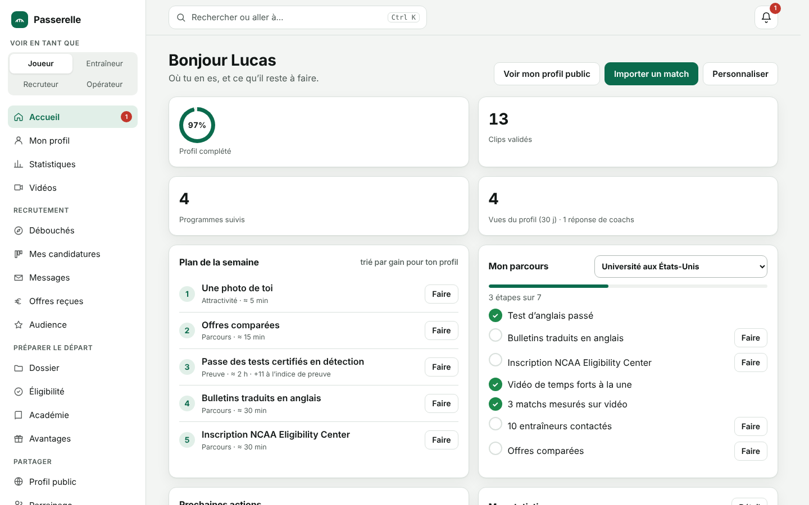
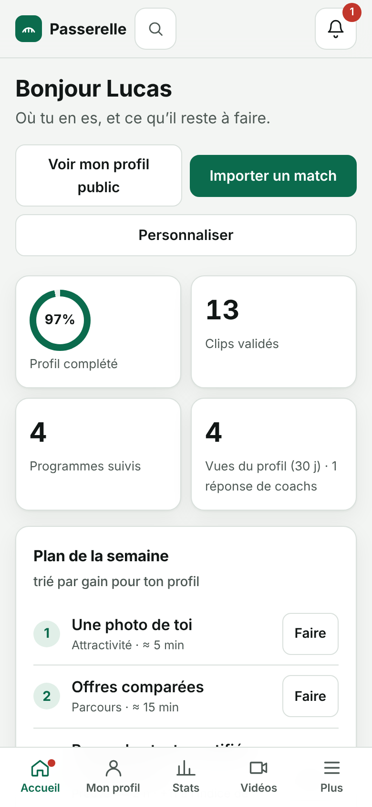

# Passerelle Football — du terrain amateur au recrutement

[](https://github.com/Skysaks/Passerelle-Football/actions/workflows/ci.yml)

> **EN** — A platform for amateur footballers with no clear path to the pro game: a profile built on verifiable proof (video-measured actions, coach-validated match sheets), weekly plans ranked by impact, and guided routes to US colleges, clubs and academies — with player, coach, recruiter and operator views.

**Démonstration** : [skysaks.github.io/Passerelle-Football](https://skysaks.github.io/Passerelle-Football/) · fichier autonome : [`dist/passerelle-football.html`](dist/passerelle-football.html) (à télécharger et ouvrir, hors ligne, sans installation). Joueurs, clubs et entraîneurs fictifs.



> © 2026 Florian Iglesias — Tous droits réservés. Dépôt public à titre de portfolio uniquement : aucune licence n'est concédée. Voir [LICENSE](LICENSE).

## Le principe

Un joueur de National 3 ou d'U19 a du niveau mais aucune vitrine crédible : ses statistiques sont déclaratives, ses vidéos brutes, et les recruteurs n'ont ni le temps ni les moyens de vérifier. Passerelle construit un **profil fait de preuves**, chaque donnée portant son niveau :

**Déclaré** → **Justifié** (document) → **Validé par l'entraîneur** → **Mesuré sur vidéo** (actions validées une à une) → **Certifié** (test encadré).

Les recruteurs filtrent sur ce niveau ; le joueur voit chaque semaine les actions qui font le plus progresser son profil.

## Fonctionnalités

**Joueur**
- Accueil composé de blocs, orienté par l'objectif choisi (université aux États-Unis, club, académie) ; plan de la semaine trié par gain pour le profil.
- Profil, statistiques par match avec graphiques, indice de preuve ; profil public personnalisable (français, anglais, espagnol) avec QR code.
- Vidéo : import d'un match, choix du joueur (clic, numéro, couleur), projecteur, ralenti, annotation, studio de montage (cartons, sous-titres, format vertical), chapitres.
- Débouchés, candidatures, messages, offres reçues et comparées, audience du profil, dossier de départ, éligibilité, académie.

**Entraîneur** — valider les feuilles de match de l'effectif, rédiger des recommandations, suivre ses joueurs.
**Recruteur** — recherche filtrée par niveau de preuve, comparaison de joueurs, recherches enregistrées, détections et stages.
**Opérateur** — modèle économique, abonnements et accès solidaire, organisations partenaires, calibrage des seuils de confiance, suivi du moteur vidéo et de son coût par match.

**Moteurs de la plateforme**
- **Cohérence** : ce qui est déclaré tient-il debout (minutes jouées au-delà de 95 par match, buts et passes improbables…) ?
- **Priorités** : quelle action rapporte le plus au profil maintenant ?
- **Correspondance** : adéquation sportive mesurée entre un joueur et un programme, par paliers.

**Ergonomie** — palette de commandes (`Ctrl K`), annulation au lieu de doubles confirmations, validation sous les champs, fenêtres accessibles au clavier, thème et taille du texte réglables, barre d'onglets au pouce sur téléphone.

| Ordinateur | Téléphone |
|---|---|
|  |  |

## Ce qui est simulé

L'**analyse vidéo** de cette démonstration est simulée : l'interface importe les résultats au format du moteur (versions 0.2 et 0.3 : passes, conduites, frappes, récupérations, données physiques) et la population de référence des comparaisons est générée. La feuille de route du moteur (détection réentraînée sur le football amateur, lecture des numéros, calibrage par les lignes du terrain) est décrite dans la vue opérateur.

## Construire et tester

Node 22 (voir `.nvmrc`). Aucune dépendance d'exécution ; Playwright sert uniquement aux tests.

```bash
npm ci
npm run dev        # http://localhost:5173, reconstruit à chaque modification de src/
npm run build      # src/ → dist/passerelle-football.html (fichier unique)
npm run verify     # aucune ressource externe, budget de taille, aucune donnée personnelle
npm test           # tests d'intégrité (node:test) + parcours bureau et mobile (Playwright)
npm run captures   # régénère docs/captures/
```

## Structure du dépôt

```
src/
  index.html                  gabarit : coquille, graine d'état (JSON), ordre des modules
  styles/                     01-base … 05-ajustements
  js/
    01-referentiels.js … 12-evenements.js     socle : données, état, vues des trois rôles, actions, événements
    13-medias-offres-audience.js … 16-…       offres, audience, dossier, abonnements, partenariats, organisations
    17-ergonomie-accessibilite.js             fenêtres accessibles, annulation, palette de commandes, thème
    18-moteur-video.js … 21-video-studio.js   moteur vidéo, preuves et statistiques, profil public, studio
    22-apparence-accueil.js … 24-…            accueil personnalisable, moteurs de la plateforme, rapport de match et QR code
    25-demarrage.js
dist/passerelle-football.html fichier construit, autonome (≈ 490 Ko)
scripts/  tests/  docs/
```

## Choix techniques

- **Des registres plutôt qu'un framework** : les vues (`VIEWS`) et les actions (`ACT`) sont des tables ; chaque module ajoute les siennes. Une fonctionnalité nouvelle s'insère sans modifier le socle.
- **Migrations de schéma** : l'état enregistré porte une version ; chaque évolution du modèle de données arrive avec sa migration, appliquée au chargement.
- **QR code sans dépendance** : encodage en mode octet, correction M, versions 1 à 10, écrit pour l'occasion (`24-qr-rapport-de-match.js`).
- **Graphiques SVG maison** : aucune bibliothèque de graphiques.
- **Un seul fichier, aucune requête** : le produit doit pouvoir être envoyé à un joueur ou à un club et s'ouvrir partout.

## Limites connues

1. **Analyse vidéo simulée** et population de référence générée : aucune mesure n'est issue de vraies vidéos dans cette démonstration.
2. **Données dans ce navigateur** (`localStorage`) : pas de compte ni de synchronisation entre appareils.
3. **Taille** : ≈ 490 Ko et 3 500 lignes de JavaScript, à découper en modules ES le jour où un serveur entre en jeu.
4. **Tests automatiques sur Chromium** (bureau et mobile émulé) ; Safari et Firefox ne sont pas couverts par la CI.

## Sécurité et confidentialité

Aucune donnée réelle : joueurs, clubs et entraîneurs inventés. Les données saisies restent dans le navigateur. Signalement des failles : [SECURITY.md](SECURITY.md).

## Licence

© 2026 Florian Iglesias — Tous droits réservés ([LICENSE](LICENSE)). Contributions : [CONTRIBUTING.md](CONTRIBUTING.md).
