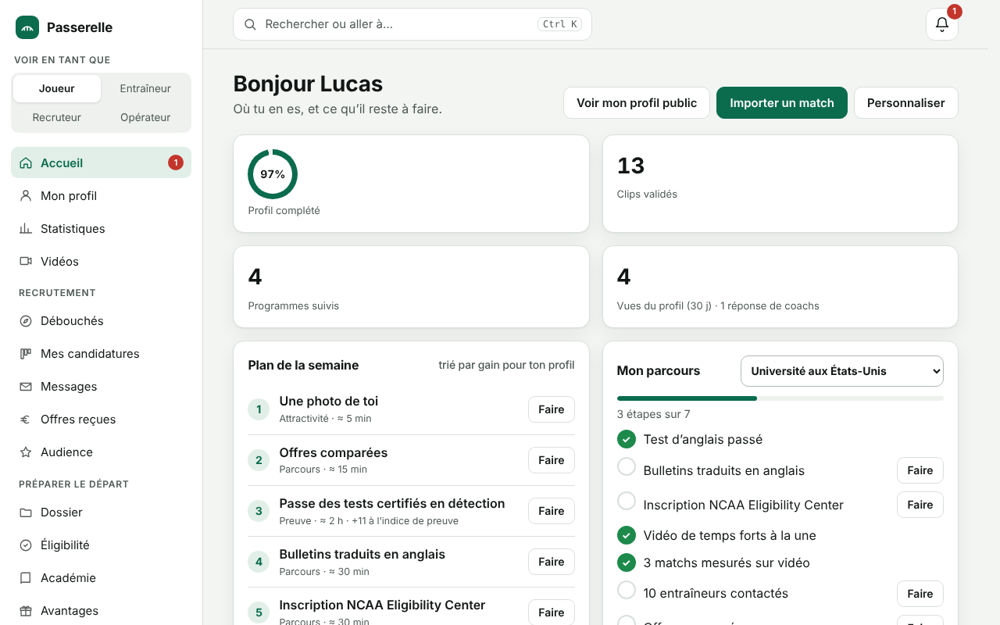

# PASSERELLE-FOOTBALL

Plateforme pour les joueurs de football sans voie professionnelle tracée : profil vérifiable, vidéo, statistiques et parcours vers les débouchés à l'étranger (universités américaines, clubs, académies).

## Fonctionnalités

- Quatre points de vue sur le même produit : joueur, entraîneur, recruteur, opérateur
- Profil joueur public (avec QR code), statistiques, clips vidéo validés et indice de preuve
- Plan de la semaine trié par gain pour le profil, parcours guidés (par exemple université aux États-Unis : anglais, éligibilité NCAA, contacts d'entraîneurs)
- Recrutement : débouchés, candidatures, messages, offres reçues, audience du profil
- Préparation du départ : dossier, éligibilité, académie, avantages partenaires
- Analyse vidéo simulée dans ce prototype ; données d'exemple fictives

## Lancer

Ouvrir `index.html` dans un navigateur. Aucune installation, aucun réseau requis.

## Fonctions connectées

La rédaction assistée (messages aux entraîneurs, résumé en anglais) et les exports s'activent lorsque la page est publiée comme artefact sur claude.ai, qui fournit l'accès à un modèle de langage, les téléchargements et le stockage de fichiers. Ouverte directement dans un navigateur, l'application bascule en mode local : tous les parcours restent utilisables avec les modèles de messages intégrés.

## Technique

Application monofichier en JavaScript sans dépendance, responsive du téléphone au bureau.

## Statut

Prototype fonctionnel.

## Droits

© 2026 Florian Iglesias – Tous droits réservés. Code publié à titre de présentation : aucune licence d'utilisation, de copie ou de redistribution n'est accordée.
